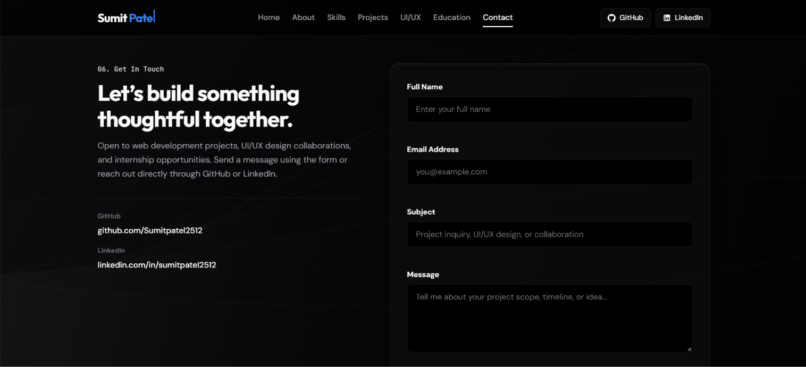

# Sumit.Dev – Personal Portfolio

## Website Screenshots




## About Me

Hello! I am Sumit Patel, a Computer Engineering student interested in web development, software development, and UI/UX design.

This portfolio showcases my skills, projects, education, and design work.

## Technologies Used

- HTML5
- CSS3
- JavaScript
- Python
- Flutter
- MongoDB
- Firebase
- Figma

## Portfolio Sections

- Home
- About Me
- Skills
- Projects
- UI/UX Designs
- Education
- Contact

## Featured Projects

1. Student Management System
2. XP Farm Student Hub
3. Bus Ticket Booking Platform
4. Treasure Hunt Adventure Game
5. AI-Based Online Exam Proctoring System
   
## Future Improvements

- Add more personal projects.
- Improve website animations.
- Add new technologies and skills.
- Enhance mobile user experience.

## Features

- Responsive design
- Interactive navigation
- Animated effects
- Project card interactions
- Contact form validation
- Back to top button

## Project Structure

```text
Portfolio Website/
│
├── index.html
│
├── css/
│   └── style.css
│
├── js/
│   └── main.js
│
└── assets/
    ├── icons/
    └── images/
```

## Author

Sumit Patel

## License

Created for educational purposes.

## Contact

If you want to connect with me or know more about my projects, visit my portfolio website.

- Portfolio: https://sumitpatel2512.github.io/Sumit_Patel_267530_Portfolio/
- GitHub: https://github.com/Sumitpatel2512

## Live Website

[Visit My Portfolio](https://sumitpatel2512.github.io/Sumit_Patel_267530_Portfolio/)

## How to Run Locally

1. Download or clone this repository.
2. Extract the project files.
3. Open the Portfolio Website folder.
4. Open index.html in your browser.

## Technologies

This project is built using HTML5, CSS3 and Vanilla JavaScript.
