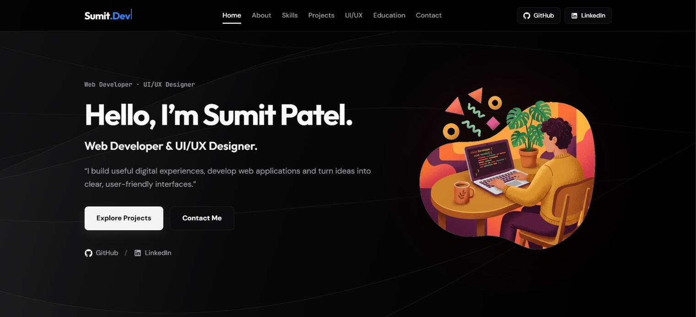
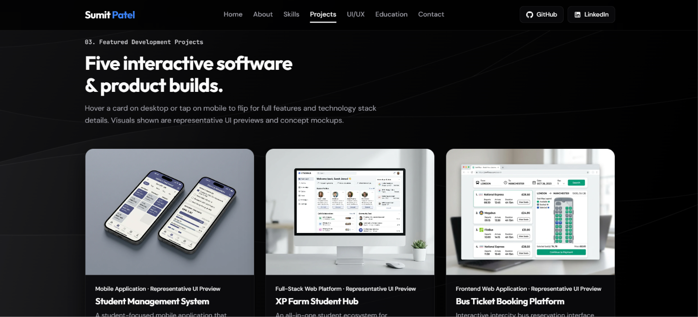

# Sumit.Dev – Personal Portfolio

## Website Screenshot





## About Me
Hello! I am Sumit Patel, a Computer Engineering student interested in web development, software development, and UI/UX design.

This portfolio showcases my skills, projects, education, and design work.

## Technologies Used
- HTML5
- CSS3
- JavaScript
- Python
- Flutter
- MongoDB
- Firebase
- Figma

## Portfolio Sections
- Home
- About Me
- Skills
- Projects
- UI/UX Designs
- Education
- Contact

## Featured Projects
1. Student Management System
2. XP Farm Student Hub
3. Bus Ticket Booking Platform
4. Treasure Hunt Adventure Game
5. AI-Based Online Exam Proctoring System

## Features
- Responsive design
- Interactive navigation
- Animated effects
- Project card interactions
- Contact form validation
- Back to top button


## Project Structure

```text
Portfolio Website/
│
├── index.html
│
├── css/
│   └── style.css
│
├── js/
│   └── main.js
│
└── assets/
    ├── icons/
    └── images/
```


## Author
Sumit Patel

## License
Created for educational purposes.
